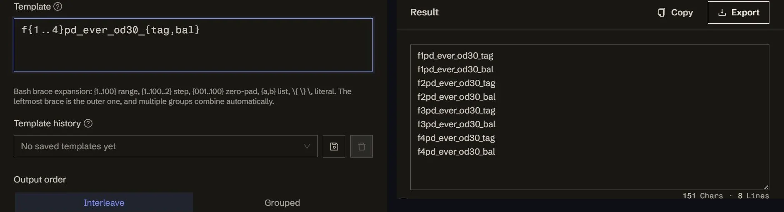

<h1 align="center">
Brace Expander
</h1>

    <em>Stop hand-typing 100 field names — write one bash-brace template</em>

   

    <a href="https://tools.newzone.top/en/brace-expander"><b>👉 Try it online</b></a> · <a href="./README.zh.md">简体中文</a>

**What it does**: you write one line — `f{1..4}pd_ever_od30_{tag,bal}` — and get all eight names at once. The syntax is bash brace expansion and the output matches bash line for line, so anything you can type in a shell you can type here. Several brace groups combine on their own, and a line separator plus a global prefix/suffix turn the list into complete SQL statements.

## Where it works

| Aspect | Detail |
| --- | --- |
| **Runs on** | any modern browser — no install, no build step, works offline |
| **Output ceiling** | 10,000 lines per run; past that it says so instead of quietly truncating |
| **Your data** | never leaves the page — the expansion is pure client-side JavaScript |
| **Interface** | 19 locales, switchable in the header: English · 简体中文 · 繁體中文 · Español · Português · Français · Deutsch · Italiano · 日本語 · 한국어 · हिन्दी · বাংলা · Bahasa Indonesia · Tiếng Việt · ไทย · Русский · Türkçe · العربية · Magyar |
| **Parity with bash** | identical for every brace form below; the only deliberate difference is the grouped order described under Known limitations |

## Key Features

- **Bash brace expansion**: `{1..100}`, `{1..100..2}` steps, `{001..100}` zero-padded, `{a..e}` letters, `{tag,bal}` lists, and `\{` `\}` `\,` for literals
- **Cartesian product**: several brace groups combine without asking — `{a,b}{1,2}` → `a1 a2 b1 b2`
- **Either output order**: **Interleave** (default, matches bash) or **Grouped**, where the rightmost variable runs all the way through — same items, different arrangement
- **Whole-block wrapping**: a line separator plus a global prefix/suffix build `IN ('a', 'b')`, JSON arrays, INSERT statements in one shot
- **Template history**: keep the recipes you reuse and pull them back in one click

## How to Use

1. Open the demo above and type one line into **Template**, e.g. `f{1..4}pd_ever_od30_{tag,bal}`.
2. The expanded list appears immediately below, with a live line count.
3. **Copy** or **Export** it. To wrap it in SQL or JSON, set the line separator and the global prefix / suffix.

Need several rules? Write several lines — each expands on its own and they concatenate in order. Click **save** to keep a template you use often.

## Recipes

- **Field names in bulk** — `f{1..100}pd_ever_od30_{tag,bal}`
- **URL list** — `https://example.com/{a,b,c}/{1..20}`
- **Filenames** — `img_{001..100}.png`
- **SQL `IN (...)`** — template `'{1}'`, separator `, `, prefix `IN (` and suffix `)`
- **SQL `INSERT ... VALUES`** — template `('{1}', '{2}')`, separator `,\n`, global prefix `INSERT INTO t (a, b) VALUES\n` and suffix `;`
- **JSON array** — template `"{1}"`, separator `,\n`, prefix `[\n` and suffix `\n]`

## Known Limitations

- **Grouped output is not bash.** The rightmost variable running to completion first is a deliberate addition; bash always interleaves. The items are identical either way — only the order differs.
- **The 10,000-line ceiling.** Templates that expand past it produce nothing rather than a partial list, so you can narrow the range instead of shipping half a result.
- **Typos stay literal.** `{a}`, `{1..}` and `{1..3.5}` are not valid brace forms, so they come out exactly as written instead of raising an error. That makes a broken template obvious rather than silently short.

## Documentation & Deployment

For detailed usage instructions and deployment guides, see the **[Official Documentation](https://docs.newzone.top/en/guide/text/brace-expander.html)**.

## About the 365 Open Source Plan

Project **#043** of the [365 Open Source Plan](https://github.com/rockbenben/365opensource) — one person + AI, 300+ open-source projects in a year.

[Submit your idea →](https://365.aishort.top/) · [Discord](https://discord.gg/PZTQfJ4GjX) · [Telegram](https://t.me/aishort_top)
